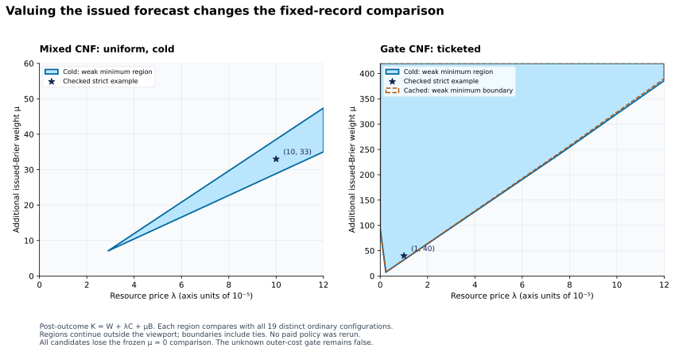

> **Portable math view.** [Preserved source](../../v3/work_logs/P3_10_2026-10-11_S1/reviews/certificate_reconstruction/claim_ledger_dispositions_review_v1/results_section4_4.reviewed.md) · [Formatting and provenance](../math_markdown.md).
> Mathematical delimiters and the repository's operator notation are normalized;
> relative links are rebased. The source's evidence bytes remain unchanged.

### 4.4 Forecast quality is an additional objective, not part of W/C dominance

The ordinary witnesses in Section 4.3 have worse issued Brier scores than the
candidates. Their W/C dominance therefore cannot be called dominance of every
aspect of the forecasting service. An explicitly post-outcome sensitivity
examines the saved symmetric-stakes paths under

```math
K_{\lambda,\mu}=W+\lambda C+\mu B,\qquad \lambda,\mu\ge0,
```

where C is the existing complete cold terminal bill per scheduled request and
B is the already issued forecast's Brier mean. The new mu gives a separate
value to forecast quality. No policy is rerun, the four asymmetric rows are
excluded with their identities recorded, and the 19 distinct ordinary
configurations in each family remain complete. Optional paid report fees
remain separate because a report is a further, unequal service.

Exact intersection of all ordinary-comparison halfplanes gives **three
nonempty candidate regions and nine empty regions** over all nonnegative
lambda/mu, not merely a chosen grid. The nonempty regions have checked strict
interior witnesses. The empty regions have exact nonnegative contradiction
multipliers; separate small-rational convex certificates make the limitation
readable. Every case also retains all vertices and boundary ties.

| Family and candidate | Illustrative lambda | Illustrative mu | Candidate K | Best distinct ordinary K | Ordinary minus candidate |
| --- | --- | --- | --- | --- | --- |
| Mixed, uniform cold | 1/10000 | 33 | 6.9261420076 | 6.9379139779 | +0.0117719703 |
| Gate, ticketed cold | 1/100000 | 40 | 10.2075857515 | 10.3636404297 | +0.1560546782 |
| Gate, ticketed cached | 1/100000 | 40 | 10.2139468582 | 10.3636404297 | +0.1496935714 |

The best ordinary comparator at the displayed mixed point is
`finite_uniform_cold`; at both gate points it is `proof_dpll_fallback1`.
These exact illustrative score gaps are not new frozen practical effects:
the original 0.01 convention is not reassigned to this differently weighted
score. The mixed region begins at lambda
`33879677331/1174898504754520`, about 0.0000288363. Both gate ticketed regions
extend to lambda=0 only at sufficiently large Brier weight. All three are
unbounded in the jointly varying price domain; a plotted viewport is not their
full support.

This unboundedness lets mu vary with lambda. Holding any finite mu fixed,
each of these candidates eventually loses as lambda rises: its C is larger
than `no_compute_0`'s, so the positive resource-cost difference eventually
dominates its fixed action/forecast terms. The mixed region also requires a
positive lambda because an ordinary combination has both lower W and lower B
at zero resource price. Its sole vertex is the intersection of that control
with `finite_uniform_cold`. The [boundary interpretation](../../v3/work_logs/P3_10_2026-10-11_S1/forecast_action_price_boundary_interpretation.md)
states these quantifiers and preserves the complete nineteen-control scope.

The nine empty regions have a simpler explanation than their large rational
elimination coefficients suggest. Five candidate cells are strictly worse in
W, C and B than a single recorded ordinary method. For the other four, a
mathematical convex combination of two ordinary records is strictly lower in
all three coordinates:

| Candidate cells | Ordinary-record combination |
| --- | --- |
| Cheap-null uniform cold | One half `probability_cost` plus one half `ordinary_combo_hashed_p1_10000` |
| Mixed uniform cached | Nine tenths `finite_uniform_cold` plus one tenth `ordinary_combo_hashed_p1_10000` |
| Both gate uniform cells | Two thirds `proof_dpll_fallback1` plus one third `probability_cost` |

For each fixed nonnegative price pair, at least one component has K no larger
than that combination's mean, hence strictly smaller than the candidate.
This is a finite catalogue certificate. It is not a newly executed randomized
controller, does not choose a method separately for each query, and does not
establish domination under every conceivable nonlinear utility. All exact
coordinate gaps and all nine certificates remain in the linked output.

The two gate ticketed candidates have identical W and B, while cold has lower
C. Thus cold beats cached at positive lambda even where both beat the distinct
ordinary catalogue. The separate identical-kernel comparisons remain: a
positive result against this distinct finite catalogue is not exclusive
advantage over ordinary reasoning. The frozen mu=0 terminal comparison remains
adverse for every candidate, and the original unknown-prefix global economic
gate remains false throughout this interpretation.

Evidence: [pre-calculation sensitivity derivation](../../v3/work_logs/P3_10_2026-10-11_S1/forecast_action_price_derivation.md),
[all twelve exact regions and contradiction certificates](../../v3/work_logs/P3_10_2026-10-11_S1/forecast_action_price_observation_A1/results.json), and
[readable points, ordinary ties and coordinate gaps](../../v3/work_logs/P3_10_2026-10-11_S1/forecast_action_price_readable_A1/interpretation.md).



The figure uses exact rational halfplane clipping; decimal conversion occurs
only when rendering. Its two vertical scales differ, as labeled. Shading
includes boundary ties against the distinct ordinary catalogue and is not a
probability or confidence region. The [figure manifest](../../v3/work_logs/P3_10_2026-10-11_S1/forecast_action_price_figure_A1_v2/manifest.json)
retains the exact clipped vertices and source bindings.
